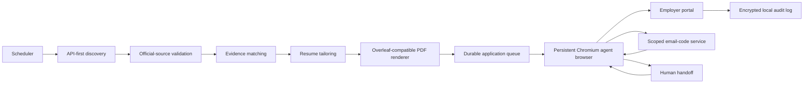

# Production roadmap: autonomous application runtime

## Current implementation status

The repository has a scheduled discovery-to-application CLI, official-source
validation, evidence-backed Jake résumé generation, Overleaf PDF compilation,
encrypted macOS state and Keychain secrets, a persistent BrowserOS neo adapter,
guarded form filling and submission confirmation, scoped mailbox OAuth and
email-code entry, exact-domain login and account creation, and same-tab human
recovery. These paths have automated tests and the merged changes passed Bugbot,
security review, CI, and CodeQL.

The product promise below is **not yet a release claim**. The current browser is
separately installed BrowserOS neo; it is not bundled into an app. The local
Playwright fallback has its own profile. Provider-specific application adapters,
automated visual PDF inspection, Windows/Linux secret stores, first-run user UI,
signed installer/updater, and live provider beta validation remain open. The
general-availability gates in this document have not been met.

## Product promise

OpenApply discovers eligible jobs, validates them against official sources,
tailors an evidence-backed résumé, creates a verified PDF, completes supported
application forms in a persistent local browser, and verifies submission. It
runs unattended until an exception requires the user.

The product is described as **autonomous with exception-based human handoff**.
It does not claim to bypass CAPTCHA, security keys, authenticator-app MFA,
account recovery, access controls, or unknown legal and compliance questions.

## Architecture



The application state machine is durable and idempotent:

```text
discovered -> validated -> matched -> tailored -> rendered -> applying
  -> waiting-email-code | waiting-human
  -> submitted | blocked | skipped | failed-retryable
```

Every transition records its input fingerprint and outcome so a crash or restart
does not duplicate an application or repeat a submission.

## Pull-request plan

Each PR should normally remain between 100 and 400 changed lines, include its
tests, update relevant documentation, and leave `main` deployable. Foundations
are stacked only when a consumer cannot be reviewed independently.

### PR 1 — Authentication policy and secret boundaries

- Add browser-profile, site-account, account-creation, and email-code policy.
- Permit only OS secret references in configuration; reject plaintext secrets.
- Document explicit profile-import consent and persistent-session behavior.
- Tests: schema validation, domain matching, secret rejection, email-code gates.
- Rollback: remove the unused policy module; no stored data migration.

### PR 2 — CI, ownership, and repository security gates

- Add formatting/linting, typecheck, unit tests, build, and coverage thresholds.
- Add dependency review, CodeQL, secret scanning, and generated-artifact checks.
- Add `CODEOWNERS`, PR template, issue templates, and release checklist.
- Require branch protection and passing checks before merge.
- Tests: intentionally seeded fixture verifies the redaction/secret scanner while
  the real repository remains clean.

### PR 3 — Secure local storage abstraction

- Define `SecretStore`, `SessionStore`, and encrypted application-state stores.
- Implement macOS Keychain first; add Windows Credential Manager and Linux Secret
  Service behind the same contract in later platform-specific PRs.
- Redact secrets, cookies, codes, and sensitive answers from logs and errors.
- Tests: fake secret store, locked/unavailable store, rotation, deletion, redaction.
- Feature flag: `secure-storage-v1`.

### PR 4 — Persistent Chromium runtime and onboarding

- Package a dedicated Chromium profile owned by OpenApply.
- Offer browser-native, user-approved import of supported profile data.
- Preserve cookies/local storage across restarts and isolate each OS user.
- Add account/session health checks without exporting cookie values.
- Tests: first run, declined import, successful import, restart persistence,
  expired session, corrupt profile, and concurrent-process lock.
- Feature flag: `embedded-browser-v1`.

### PR 5 — Agent-native browser protocol

- Add structured accessibility/DOM snapshots and stable element references.
- Add direct `navigate`, `fill`, `select`, `click`, `upload`, `download`, and
  `waitFor` actions with post-action verification.
- Prefer structured state; use screenshots only as a fallback.
- Enforce navigation allowlists and per-domain rate limits.
- Tests: protocol contract, stale references, popup/new-tab behavior, uploads,
  downloads, navigation escape attempts, and renderer crashes.

### PR 6 — Durable orchestration and recovery

- Implement the application state machine, leases, retries, checkpoints, daily
  caps, idempotency keys, and crash recovery.
- Parallelize discovery/tailoring; serialize final submissions per user/domain.
- Add feature-flagged dry-run and prepare-only modes.
- Tests: every transition, crash at every boundary, retry exhaustion, duplicate
  job, duplicate submit, hard cap, cancellation, and upgrade migration.

### PR 7 — Deterministic ATS application adapters

- Implement Greenhouse, Ashby, Lever, SmartRecruiters, and Workday adapters.
- Map common fields deterministically before using the generic agent fallback.
- Detect CAPTCHA, unsupported controls, compliance questions, and final submit.
- Tests: versioned sanitized fixtures, optional/required fields, conditional
  questions, validation errors, multi-page applications, and site drift.
- Roll out one provider at a time behind provider flags.

### PR 8 — Résumé rendering and artifact verification

- Generate one evidence-backed Jake-template LaTeX document per role.
- Use an interchangeable renderer: Overleaf Git/interactive workflow when
  configured, with local compilation only when private policy permits it.
- Render PDF pages and verify page count, clipping, text extraction, links, and
  artifact/job fingerprints before upload.
- Tests: golden LaTeX, golden PDF metadata/text, unsupported claim rejection,
  Overleaf timeout, compile error, stale artifact, and wrong-role upload.

### PR 9 — Gmail and Microsoft email verification

- Add least-privilege OAuth onboarding and OS-keychain token storage.
- Observe only the active mailbox/application window and match expected account,
  portal, sender, timestamp, and code pattern.
- Consume one unambiguous code once; pause on ambiguity or expiry.
- Tests: Gmail and Graph contract mocks, delayed/duplicate/malicious email,
  multiple codes, expired code, revoked OAuth, and log redaction.
- Feature flag: `email-verification-v1`; disabled by default until consented.

### PR 10 — Account creation and guarded form execution

- Select accounts by verified destination domain.
- Create accounts only when `allowAccountCreation` is true.
- Use the configured email and retrieve the password at execution time.
- Never invent security answers or reuse credentials across account policies.
- Tests: existing account, new account, email verification, password-policy
  rejection, duplicate account, wrong domain, and unexpected MFA.

### PR 11 — Human handoff and resumable notifications

- Notify through desktop UI first; add optional mobile/email notification later.
- Show the exact blocker, current page, requested action, and safe resume button.
- Pause leases while awaiting the user and revalidate page state after return.
- Tests: CAPTCHA, MFA, legal question, OAuth loss, timeout, stale handoff, resume.

### PR 12 — Submission verification, audit, and beta release

- Require confirmation text, confirmation URL, application ID, portal status, or
  configured confirmation email before recording `submitted`.
- Add encrypted audit events, export, retention controls, and deletion.
- Add signed/notarized macOS package, updater rollback, telemetry opt-in, support
  bundle redaction, and beta runbook.
- Tests: full E2E matrix, update/rollback, offline/reconnect, corrupted state,
  clean uninstall, data export/deletion, and confirmation false positives.

## Review gates

Every PR requires:

1. Author self-review of the complete diff.
2. Automated unit/integration tests and changed-code coverage.
3. Bug-focused review for correctness, races, recovery, and data loss.
4. Security review for auth, browser, email, storage, and submission changes.
5. Documentation and migration/rollback notes.
6. A reviewer who did not author the security-sensitive implementation before
   enabling its feature flag by default.

High-risk PRs 3, 4, 5, 6, 7, 9, 10, and 12 require a threat-model update and a
manual abuse-case test. No review may be waived to meet a date.

## Test strategy

- **Unit:** schemas, matching, field mapping, transitions, redaction, parsers.
- **Contract:** sanitized ATS fixtures, Gmail API, Microsoft Graph, Overleaf.
- **Integration:** real local browser and keychain in an isolated test profile.
- **E2E:** dedicated test employer portals; never submit to a real employer from CI.
- **Resilience:** killed process, renderer crash, network loss, expired session,
  duplicated event, partial upload, rate limit, and retry exhaustion.
- **Security:** secret scanning, dependency review, navigation/domain escapes,
  prompt-injection content, malicious email, path traversal, and log leakage.
- **Accessibility:** keyboard-only onboarding and human-handoff flows.
- **Performance:** discovery throughput, snapshot/action latency, PDF time, queue
  recovery time, and memory use with long-lived profiles.

Production E2E tests use synthetic identities and controlled portals. Real-site
smoke tests are manual, low-volume, and must respect the site's terms and access
controls.

## Release phases

### Phase A — Foundation

PRs 1–3. Exit when CI is required, plaintext credentials are impossible through
the typed configuration, and local state has an encrypted storage contract.

### Phase B — Browser vertical slice

PRs 4–6. Exit when a persistent local profile can resume a test application
after a forced crash without duplicating a submission.

### Phase C — Application capability

PRs 7–10. Exit when at least two ATS providers pass their complete controlled
E2E suites, the correct tailored PDF is uploaded, and email verification works
with explicit consent.

### Phase D — Product beta

PRs 11–12. Exit after threat-model review, signed installer testing, data
export/deletion verification, rollback drill, and a monitored private beta.

### Phase E — General availability

Expand ATS coverage only from observed failure data. GA requires crash-free and
submission-verification targets to hold during beta, documented support/SLOs,
privacy policy and terms review, and independent security assessment.

## First-morning milestone

The safe overnight-sized milestone is PR 1 plus the PR 2 CI foundation and a
reviewed skeleton for PR 3. It must include passing typecheck, unit tests, build,
secret-boundary tests, documentation, and review findings. Bundled-browser or
real-employer submissions are not part of this milestone.

## Definition of done

A feature is done only when implementation, automated tests, documentation,
threat-model impact, migration/rollback path, telemetry/redaction behavior, and
feature-flag rollout are reviewed. A clicked Submit button is never sufficient:
the workflow must record explicit confirmation before reporting success.
